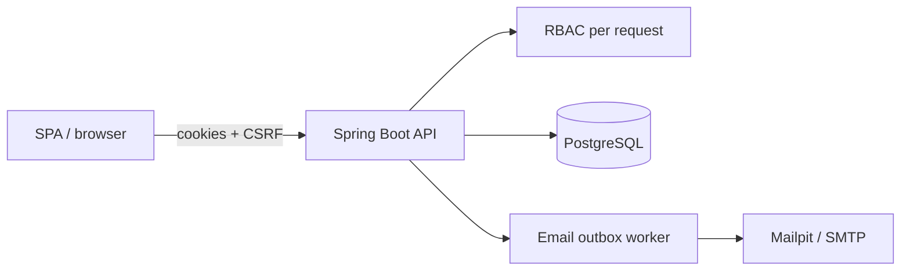

# Architecture

## Goals

Reusable **modular Spring Boot monolith** for enterprise authentication and user management. Future business apps (ERP, HR, inventory, SaaS) clone or extend this foundation; they do **not** depend on Keycloak or a microservice mesh for identity.

## Stack

| Layer | Choice |
|---|---|
| Runtime | Java 21, Spring Boot 4.1.2, Spring Security 7 |
| API | Spring Web MVC, Problem Details errors |
| Persistence | PostgreSQL 16, Flyway, Spring Data JPA |
| Tokens | ES256 JWT in HttpOnly cookies (`access_token`, `refresh_token`) |
| Passwords | Argon2id (BouncyCastle) |
| Email | Transactional outbox + AES-GCM payloads + Mailpit locally |
| Deploy local | Docker Compose (`db`, `mailpit`, `backend`) |

## High-level layout

## Package map

| Package | Responsibility |
|---|---|
| `common` | Errors, correlation ID, shared web |
| `config` | Security, CORS, CSRF, beans |
| `user` / `profile` | Accounts, status, profiles |
| `authentication` | Login, JWT, refresh, logout, cookies |
| `authorization` | Roles, permissions, catalog sync, `@PreAuthorize` |
| `invitation` | Invite + accept + bootstrap admin |
| `password` | Change / forgot / reset / email verify |
| `email` | Outbox encrypt/send |
| `mfa` | TOTP + recovery |
| `audit` | Append-only security events + retention |
| `administration` / `securitysettings` | Admin user APIs + session dashboard |
| `business.demo` | Sample Notes module (removable) |

## Security model (summary)

- **STATELESS** sessions: no server session store; access JWT validated every request.
- Refresh **families** with hashed refresh tokens, reuse detection, JTI denylist, `token_version` (`tv`).
- Fail-closed: infrastructure/DB ambiguity → **503**; clear auth failure → **401**.
- CSRF double-submit for cookie auth; Origin allowlist; security headers.
- Permissions loaded from DB **every request** (no cache); SUPER_ADMIN grant is a dedicated step-up path.
- Audit table: INSERT/SELECT for app role; retention via SECURITY DEFINER function.

## Extension point

Business modules contribute permissions through `PermissionCatalogContributor` and own Flyway migrations. See [ADDING_BUSINESS_MODULES.md](ADDING_BUSINESS_MODULES.md).

## Related docs

[PROJECT_STRUCTURE.md](PROJECT_STRUCTURE.md) · [AUTHENTICATION.md](AUTHENTICATION.md) · [AUTHORIZATION.md](AUTHORIZATION.md) · [SECURITY.md](SECURITY.md) · [DATABASE.md](DATABASE.md)
