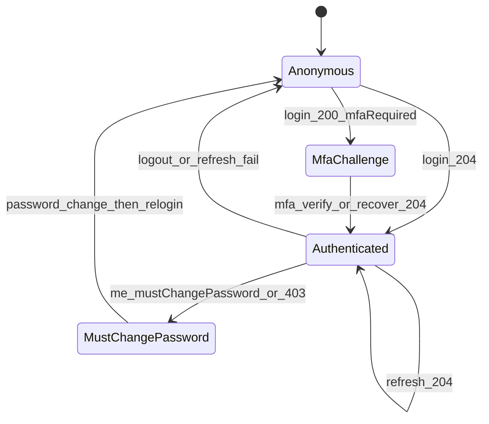

# Frontend API integration specification (Phase 17)

**Status:** Frozen contract for Angular and React (Phases 18–28). Derived from as-built controllers + Phase 16 role APIs. **Do not invent endpoints.**

Companion UX/security guide: [FRONTEND_INTEGRATION.md](FRONTEND_INTEGRATION.md) (CSRF memory token, single-flight refresh, cross-tab).  
Authorization detail: [AUTHORIZATION.md](AUTHORIZATION.md).

Both SPAs must implement this matrix independently. Run **one authenticated SPA at a time** against the same API (see §7).

Base path: `/api/v1`. Mutations: `credentials: 'include'` + `X-XSRF-TOKEN` + allowlisted `Origin`. Errors: RFC 7807 Problem Details + `errorCode`.

---

## 1. Auth state machine

| State | How entered | FE behavior |
|---|---|---|
| Anonymous | boot, logout, failed refresh | Public routes; bootstrap CSRF |
| MfaChallenge | login **200** `{ mfaRequired: true }` | MFA code / recovery UI; no access yet |
| Authenticated | login/MFA **204** + cookies | Call `GET /auth/me`; load shell |
| MustChangePassword | `/me.mustChangePassword` or **403** `PASSWORD_CHANGE_REQUIRED` | Only password-change UX + allowlisted APIs |

---

## 2. Shared client rules (both SPAs)

| Rule | Detail |
|---|---|
| API base | Local `http://localhost:8080`; never put JWTs in `localStorage` / `sessionStorage` |
| CSRF | `GET /auth/csrf` → memory token → `X-XSRF-TOKEN` on unsafe methods |
| Credentials | Always `include` |
| 401 | Single-flight `POST /auth/refresh` once; retry; else login |
| 503 | Backoff; **do not** treat as logout |
| 403 `PASSWORD_CHANGE_REQUIRED` | Force password change |
| 403 `ORIGIN_REJECTED` / CSRF | Fix Origin/CSRF config |
| Correlation | Optional `X-Correlation-Id` |
| UI permissions | Advisory from `/auth/me.permissions`; backend `@PreAuthorize` is authoritative |

Cross-tab (same origin only): `BroadcastChannel` for refresh/logout. See [FRONTEND_INTEGRATION.md](FRONTEND_INTEGRATION.md).

---

## 3. Self-service vs admin authorization (must match backend)

| Area | Backend authz | Frontend gate |
|---|---|---|
| `GET/PATCH /me/profile` | Authenticated (`isAuthenticated` on PATCH) | Any signed-in user — **do not** require `PROFILE_UPDATE` |
| `/me/mfa/**` | Authenticated only | Any signed-in user — **do not** require `MFA_MANAGE` |
| `/me/password`, `/me/email-change`, `/me/security/**` | Authenticated | Any signed-in user |
| `GET/PATCH /admin/users/{id}/profile` | `PROFILE_READ` / `PROFILE_ADMIN_UPDATE` | Those permissions |
| Admin MFA reset | `MFA_ADMIN_RESET` | `MFA_ADMIN_RESET` |
| `GET /admin/permissions` | `PERMISSION_READ` | `PERMISSION_READ` |
| `/admin/roles/**` | `ROLE_*` + service delegation | `ROLE_*` (backend still enforces hold-`P` / subset) |
| `/admin/users/**` | `USER_*` etc. | Matching `USER_*` |

`PROFILE_UPDATE`, `MFA_MANAGE`, `PERMISSION_MANAGE` exist in the **catalog** but are **not** enforced on the self-service / invent-permission HTTP surfaces above.

---

## 4. Full endpoint matrix

Auth column: `public` = SecurityConfig permitAll (still CSRF/Origin on mutations); `auth` = valid access cookie; `perm:CODE` = `@PreAuthorize`.

### 4.1 Auth & session

| Method | Path | Auth | Request | Success | Notes |
|---|---|---|---|---|---|
| GET | `/auth/csrf` | public | — | 200 `{ token }` | Bootstrap |
| POST | `/auth/login` | public | `{ email, password }` | **204** session or **200** `{ mfaRequired: true }` | Generic 401 on failure |
| POST | `/auth/mfa/verify` | public | `{ code }` | 204 | Needs MFA challenge cookie |
| POST | `/auth/mfa/recover` | public | `{ code }` | 204 | Recovery code |
| POST | `/auth/refresh` | public | — (refresh cookie) | 204 | Single-flight |
| POST | `/auth/logout` | public | — | 204 | Always 204 |
| POST | `/auth/logout-all` | auth | — | 204 | |
| GET | `/auth/me` | auth | — | 200 `CurrentUserResponse` | See §5 |
| POST | `/auth/forgot-password` | public | `{ email }` | 204 | Enumeration-safe |
| POST | `/auth/reset-password` | public | `{ token, password }` | 204 | |
| POST | `/auth/verify-email` | public | `{ token }` | 204 | |

### 4.2 Self password / email / profile / MFA / security

| Method | Path | Auth | Request | Success |
|---|---|---|---|---|
| POST | `/me/password` | auth | `{ currentPassword, newPassword }` | 204 (clears cookies → re-login) |
| POST | `/me/email-change` | auth | `{ newEmail }` | 204 |
| GET | `/me/profile` | auth | — | 200 profile |
| PATCH | `/me/profile` | auth | `{ firstName?, lastName?, phone?, preferredLanguage?, timezone? }` | 200 |
| GET | `/me/mfa` | auth | — | `{ enabled, enrollmentPending, unusedRecoveryCodes }` |
| POST | `/me/mfa/enroll` | auth | — | `{ secretBase32, otpauthUri, expiresAt }` |
| DELETE | `/me/mfa/enroll` | auth | — | 204 |
| POST | `/me/mfa/confirm` | auth | `{ code }` | `{ recoveryCodes[] }` |
| POST | `/me/mfa/recovery-codes/regenerate` | auth | `{ password, code }` | `{ recoveryCodes[] }` |
| DELETE | `/me/mfa` | auth | `{ password, code }` | 204 |
| GET | `/me/security` | auth | — | overview (pendingEmail, mfa, session count, …) |
| GET | `/me/security/sessions` | auth | — | session summaries |
| DELETE | `/me/security/sessions/{familyId}` | auth | — | 204 (not current session) |

### 4.3 Invitations

| Method | Path | Auth | Request | Success |
|---|---|---|---|---|
| POST | `/invitations/accept` | public | `{ token, password }` | 204 |
| POST | `/admin/users/{userId}/invitations` | `USER_INVITE` | — | 204 create/resend |

### 4.4 Admin users

| Method | Path | Auth | Request / query | Success |
|---|---|---|---|---|
| POST | `/admin/users` | `USER_CREATE` | `CreateAdminUserRequest` (no password/roles/status) | 201 |
| GET | `/admin/users` | `USER_READ` | `q?`, `status?`, pageable | 200 Page |
| GET | `/admin/users/{userId}` | `USER_READ` | — | 200 |
| PATCH | `/admin/users/{userId}` | `USER_UPDATE` | firstName/lastName/phone | 200 |
| POST | `…/activate` | `USER_ACTIVATE` | — | 204 |
| POST | `…/suspend` | `USER_SUSPEND` | — | 204 |
| POST | `…/disable` | `USER_SUSPEND` | — | 204 |
| DELETE | `/admin/users/{userId}` | `USER_DELETE` | — | 204 soft-delete |
| POST | `…/restore` | `USER_RESTORE` | — | 204 |
| POST | `…/force-password-reset` | `USER_RESET_PASSWORD` | — | 204 |
| POST | `…/revoke-sessions` | `USER_REVOKE_TOKENS` | — | 204 |
| DELETE | `…/sessions/{familyId}` | `USER_REVOKE_TOKENS` | — | 204 |
| GET/PATCH | `…/profile` | `PROFILE_READ` / `PROFILE_ADMIN_UPDATE` | profile fields | 200 |
| POST | `…/mfa/reset` | `MFA_ADMIN_RESET` | — | 204 |
| POST | `…/roles` | `USER_ASSIGN_ROLE` | `{ roleCode }` | 204 (+ subset) |
| DELETE | `…/roles/{roleCode}` | `USER_ASSIGN_ROLE` or SUPER_ADMIN | — | 204 |
| POST | `…/grant-super-admin` | SUPER_ADMIN role | `{ password }` | 204 |

### 4.5 Role catalog (Phase 16)

| Method | Path | Auth | Request | Success / errors |
|---|---|---|---|---|
| GET | `/admin/roles` | `ROLE_READ` | — | 200 `RoleResponse[]` |
| GET | `/admin/roles/{roleCode}` | `ROLE_READ` | — | 200 / 404 |
| POST | `/admin/roles` | `ROLE_CREATE` | `{ code, name, description? }` | 201; 409 duplicate |
| PATCH | `/admin/roles/{roleCode}` | `ROLE_UPDATE` | `{ name?, description? }` | 200; empty PATCH → 400; `description:""` clears |
| DELETE | `/admin/roles/{roleCode}` | `ROLE_DELETE` | — | 204; **403** system; **409** if assigned |
| POST | `…/permissions` | `ROLE_ASSIGN_PERMISSION` | `{ permissionCode }` | **204 idempotent**; 403 if lack `P` / system role |
| DELETE | `…/permissions/{permissionCode}` | `ROLE_ASSIGN_PERMISSION` | — | **204 idempotent** |

`RoleResponse`: `code`, `name`, `description`, `systemRole`, `createdAt`, `permissionCodes[]`, `assignedUserCount`.

### 4.6 Permissions, audit, demo, meta

| Method | Path | Auth | Notes |
|---|---|---|---|
| GET | `/admin/permissions` | `PERMISSION_READ` | `{ code, module, description }[]` |
| GET | `/admin/audit-logs` | `AUDIT_READ` | filters `eventType`, `actorUserId`, `targetUserId`, `from`, `to`; page default size 50 |
| GET/POST/PUT/DELETE | `/demo/notes`… | `NOTE_*` | Owner-scoped |
| GET | `/meta/info` | public | `{ application, status, phase }` |
| GET | `/actuator/health` | public | Health |

---

## 5. Key response shapes

**`CurrentUserResponse`:** `id`, `email`, `firstName`, `lastName`, `status`, `emailVerified`, `mustChangePassword`, `mfaEnabled`, `roles[]`, `permissions[]`, `tokenVersion`, `authzVersion`.

**Spring `Page`:** `content`, `totalElements`, `totalPages`, `size`, `number`, `sort`, …

**Problem Details:** `title`, `detail`, `status`, `errorCode`, optional `fields`, optional `correlationId`.

FE-relevant `errorCode`s: `UNAUTHORIZED`, `FORBIDDEN`, `PASSWORD_CHANGE_REQUIRED`, `ORIGIN_REJECTED`, `VALIDATION_FAILED`, `NOT_FOUND`, `CONFLICT`, `SERVICE_UNAVAILABLE`.

---

## 6. Cookies / CORS (local)

| Item | Value |
|---|---|
| Access / refresh / MFA | `access_token`, `refresh_token`, `mfa_challenge` (HttpOnly) |
| CSRF cookie | `XSRF-TOKEN` (not readable cross-origin — use body token) |
| CORS origins | `http://localhost:4200`, `http://localhost:5173` |
| Deep links | `INVITATION_ACCEPT_BASE_URL` (`…/invite/accept`), `PASSWORD_RESET_BASE_URL` (`…/reset-password`), `EMAIL_VERIFY_BASE_URL` (`…/verify-email`) → **active** SPA origin + `?token=` |

---

## 7. Switching Angular ↔ React

1. Prefer `POST /auth/logout` or `logout-all`.
2. **Close all authenticated tabs** of the previous SPA.
3. Start the other SPA; it independently bootstraps CSRF and `/auth/me` or login.
4. Do **not** run both authenticated — shared API cookies + refresh rotation can revoke the family (reuse detection).
5. `BroadcastChannel` does not cross `:4200` ↔ `:5173`.

---

## 8. Residual backend gaps (do not invent FE-only features)

| Gap | FE handling |
|---|---|
| No invitation list/cancel | Create/resend + accept deep link only |
| No admin list of another user’s sessions | Self `/me/security/sessions` only; admin revoke-all / revoke-by-id without list |
| No invent-permission HTTP (`PERMISSION_MANAGE`) | Catalog is code-owned; view via `GET /admin/permissions` |
| No notifications / theme prefs API | Local UI theme only |
| `SECURITY_MANAGE` / `ADMIN_DASHBOARD_ACCESS` unused on dedicated controllers | Do not gate unique screens solely on these unless APIs appear later |

---

## 9. Phase 27 equivalence matrix (seed)

Both SPAs must pass the same checklist (run Angular-only, then React-only):

| # | Feature |
|---|---|
| 1 | CSRF bootstrap + memory token |
| 2 | Login without MFA |
| 3 | Login MFA verify/recover |
| 4 | `/auth/me` init (roles/permissions) |
| 5 | Single-flight refresh on 401 |
| 6 | Same-origin cross-tab refresh |
| 7 | 503 ≠ logout |
| 8–9 | Logout / logout-all |
| 10–13 | Forgot / reset / change / must-change password |
| 14–15 | Email change + verify |
| 16–19 | MFA enroll / QR / confirm / disable / recovery |
| 20 | Self profile (authenticated, not `PROFILE_UPDATE`) |
| 21–26 | User admin + invite accept |
| 27 | Permission catalog (`PERMISSION_READ`) |
| 28–30 | Role CRUD + permission attach/detach |
| 31–32 | Assign/remove roles + grant SUPER_ADMIN |
| 33 | Permission-based nav (advisory) |
| 34–35 | Security overview + sessions |
| 36 | Audit logs |
| 37 | Dashboard shell |
| 38 | Demo notes (`NOTE_*`) |
| 39 | No JWT in web storage |
| 40 | SPA switchover discipline (§7) |

Full sign-off: [FRONTEND_EQUIVALENCE.md](FRONTEND_EQUIVALENCE.md) (Phase 27). Automated suites: [FRONTEND_TESTING.md](FRONTEND_TESTING.md).

---

## 10. Acceptance (Phase 17)

- [x] Matrix lists only real endpoints (including Phase 16 roles).
- [x] Self vs admin authz matches controllers (§3).
- [x] Switchover and residual gaps documented.
- [x] Phase 27 seed present for both SPAs.
- [x] No invented APIs.
